# Ball Cascade — Visual Redesign Report

## Scope and release boundary

Review branch: feature/visual-overhaul, based on published 0.3.1 at 4a2cac1a58dc9bc6895aa13895ababa4607d1a67. Main and the public Pages site are not changed by this task. This is a review candidate, not a platform certification or a claim of improved retention.

Ten core modules are byte-equivalent in Git to the baseline: Engine, physics, goals, levels, economy, saves, math, obstacles, audio and platform adapter. Budgets, upgrade costs, reward calculation, rules and fixed-step timing are unchanged. The canonical automated campaign JSON is also unchanged. The only input correction is separately committed as 84d595d: real touch testing found that smooth small pointer events did not satisfy the pre-existing tutorial movement thresholds. The controller now recognizes the same thresholds across a whole real gesture; it changes no ball position, goal number or physics parameter.

## Art direction and what changed

**Neon Cabinet / modern casual arcade.** A deep navy/teal chamber, lime launch/target lights, cyan flow, purple splitting and gold rewards form one visual language. Original vector/SVG/Canvas artwork replaces flat prototype pieces. No external graphics, fonts, decorative libraries or copied logos are used.

- **Hierarchy:** compact level identity in the toolbar, a short mission and meter, remaining-ball counters, then the chamber and a dominant launch button. Extra conditions stay visible as chips; full rules move to Help. Practice explicitly says it is unscored, instead of presenting zeros as failed scoring.
- **Cabinet:** inset metallic edges, a cached depth/grid backdrop, pearl ball sprites, socketed pegs, beveled modules, luminous pockets, striped danger surfaces, rotating portal rings and directional wind. Physical bodies and trajectories retain their original coordinates.
- **Controls:** highlighted lime launch, quiet blue rebuild, accessible 44px toolbar controls and numbered stage tiles. Full stage names stay in the header, accessible label and tooltip, avoiding illegible tiny captions.
- **Workshop:** colored tuning icons, six-segment levels, a coin capsule and readable available/disabled states. It remains the same three tracks at the same prices.
- **Results:** medal and three sequenced stars, a cosmetic coin count-up, compact score cards, immediate Next/Replay. Defeat names unmet conditions in a calm amber panel with a prominent retry action. Rewards are still awarded exactly once by Engine, never by animation.

Reusable tokens, materials, SVG icons and Canvas helpers are documented in [VISUAL_COMPONENTS.md](VISUAL_COMPONENTS.md).

## Matched-state comparisons

These are real Chrome screenshots, not image-generation mockups. The comparison contexts load the **same unmodified save snapshot earned by the real After campaign**. They are not counted as campaign completion evidence. Save SHA-256: 577cb41625378add0aeccf37c2891455516782957a45e477706ef831a79a5fee. Both versions load the same level, layout, aim, upgrades, money and completion state; preview ball positions may differ slightly with browser timing.

| View | Before | After |
|---|---|---|
| Desktop, identical earned profile | 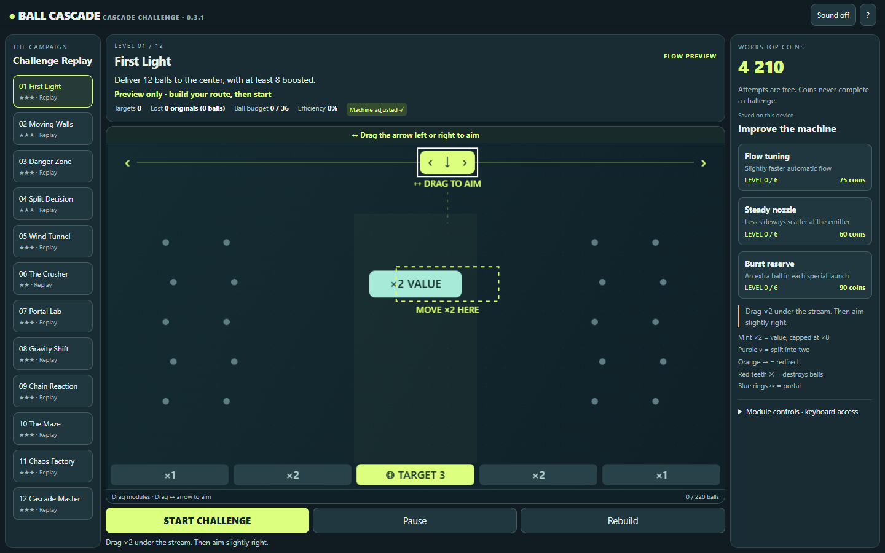 | 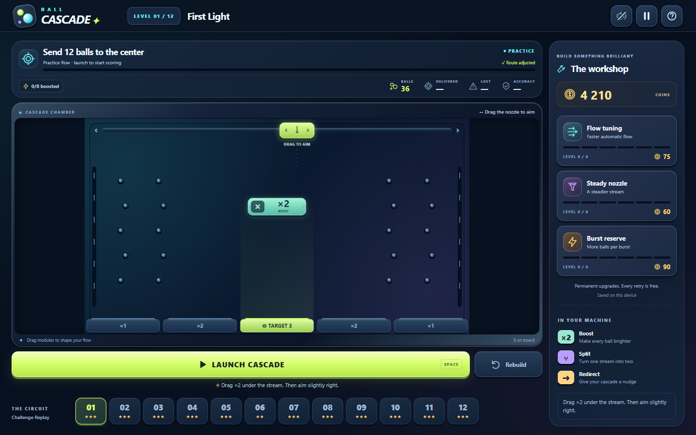 |
| Phone, identical earned profile | 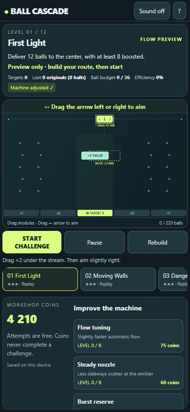 | 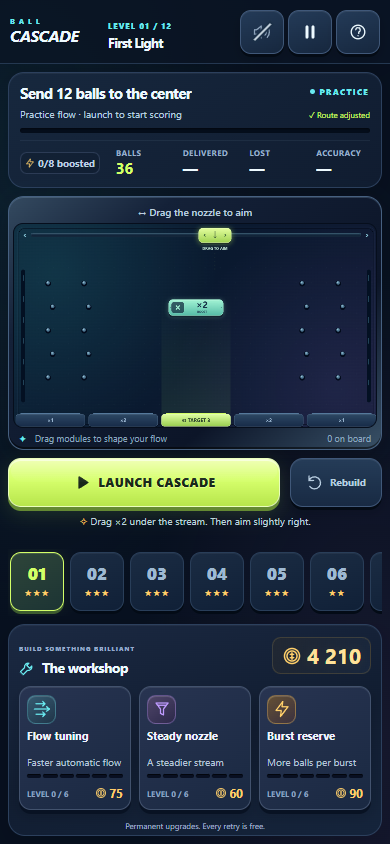 |

## Required real gameplay screens

The following states were reached with visible controls in isolated browser contexts. Both full campaigns started fresh, including one deliberate failure, with no injected victories or modified balances. The initial screen uses the default machine; play/obstacle captures pause the real flow near the same emission budget. Victory and first-clear workshop views both show 32/36 delivered, 89% accuracy and 160 earned coins. The later live counters are not frame-synchronized.

| State | Before | After |
|---|---|---|
| First Light, before launch | 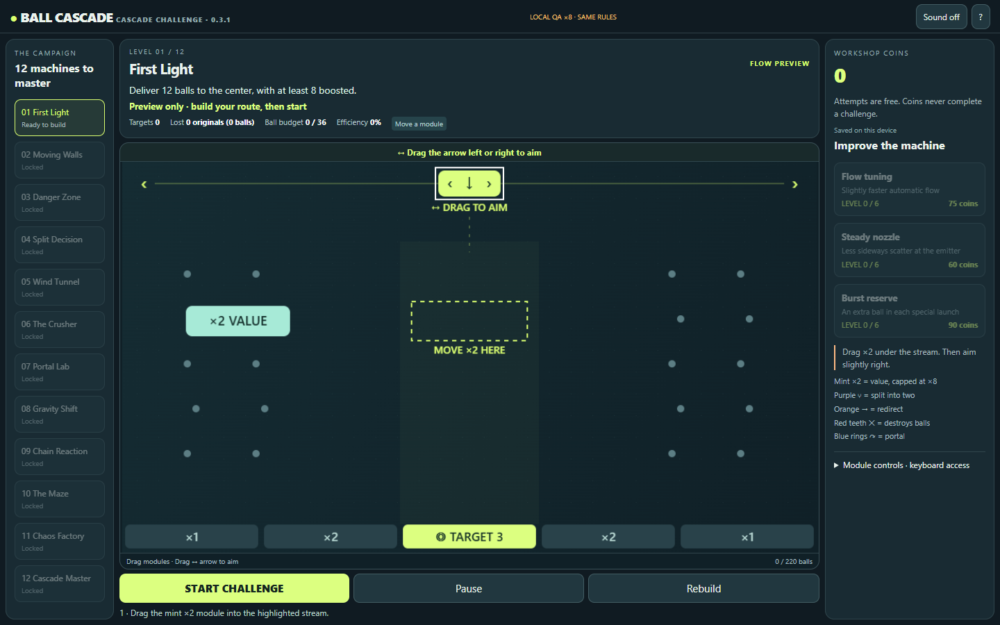 | 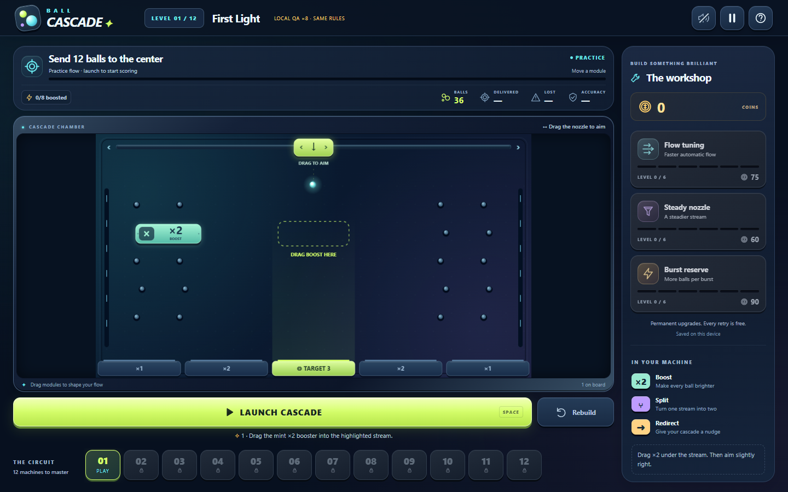 |
| First Light, in play (paused to inspect) | 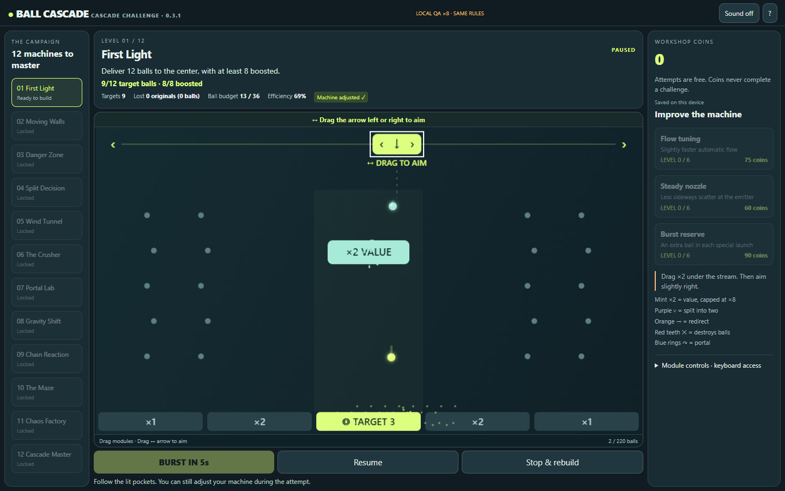 | 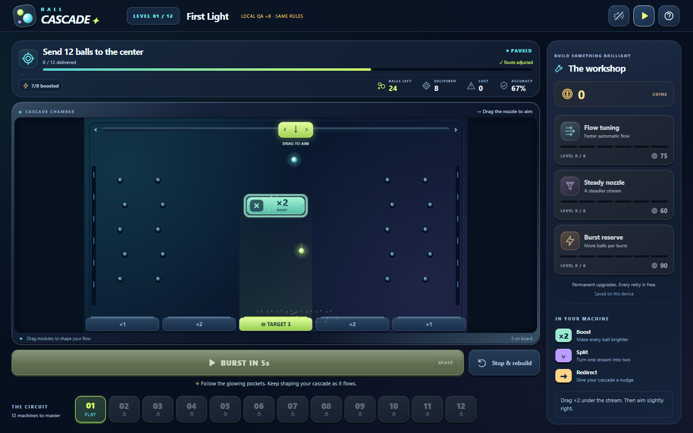 |
| Chaos Factory obstacles | 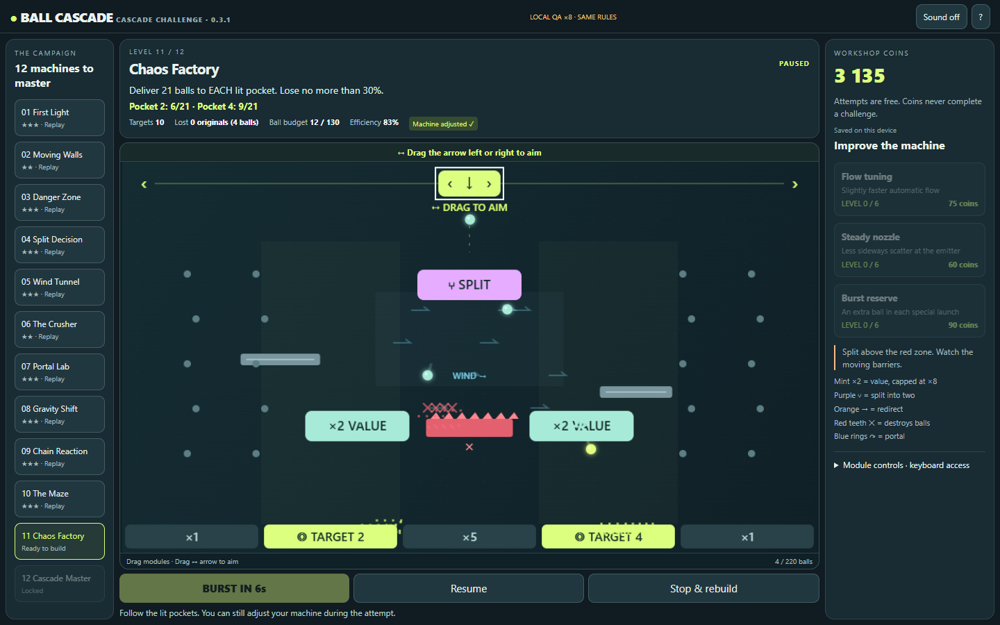 | 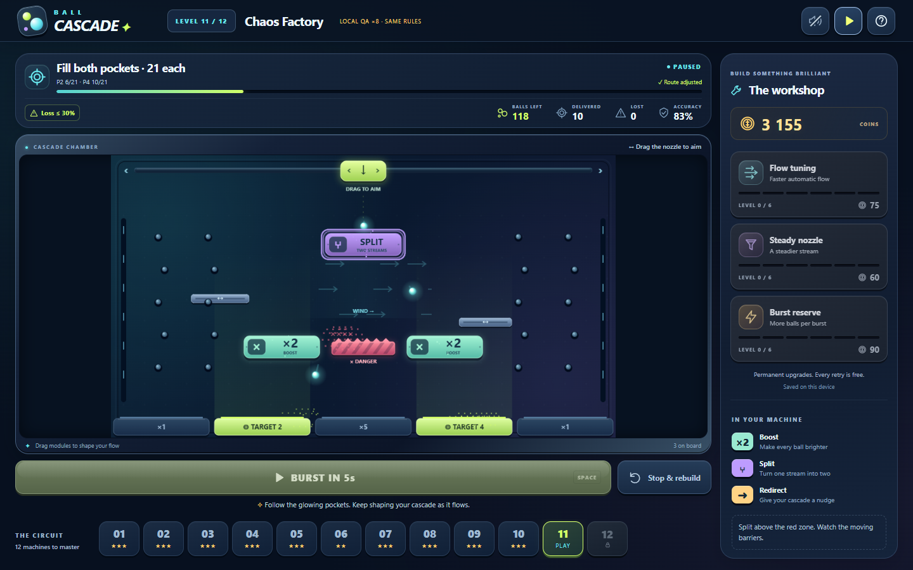 |
| Victory | 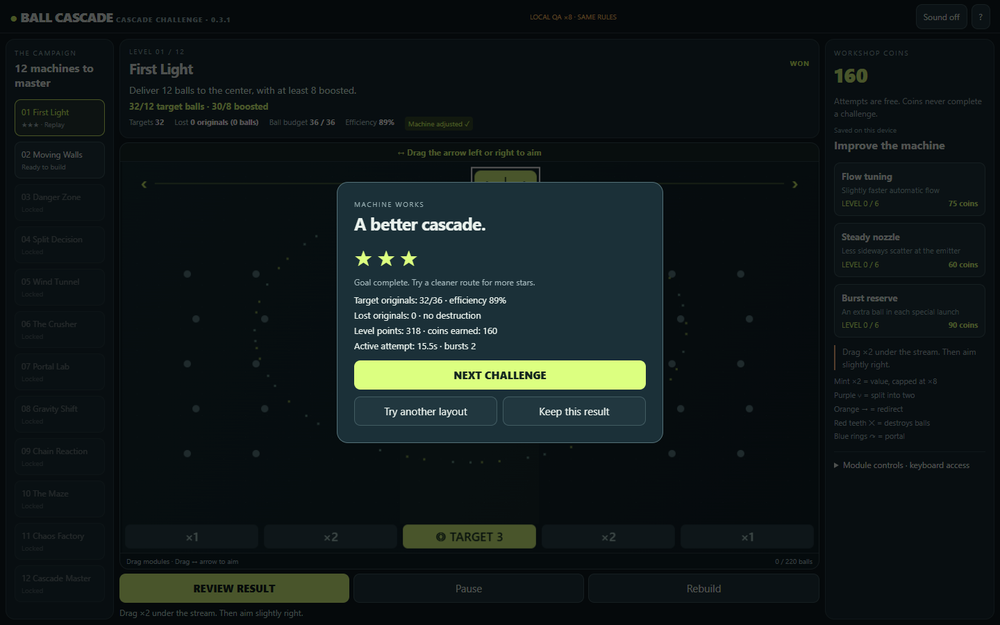 | 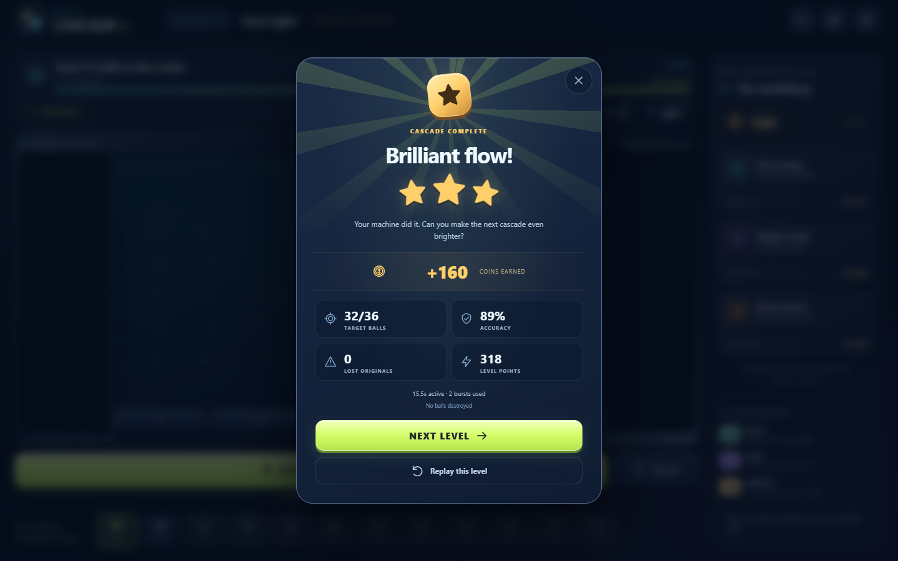 |
| Defeat | 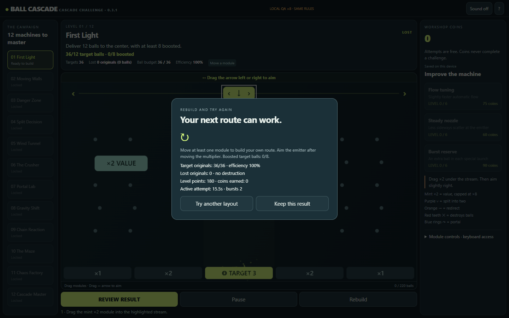 | 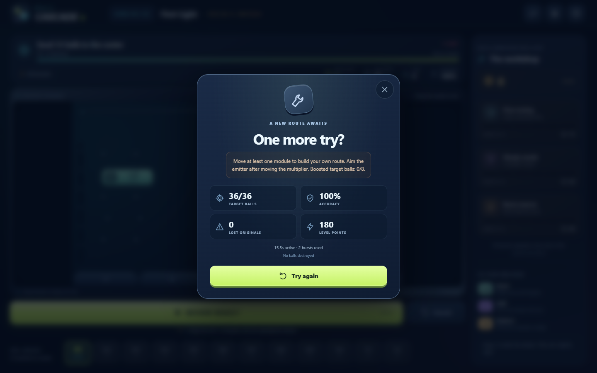 |
| Workshop after first clear | 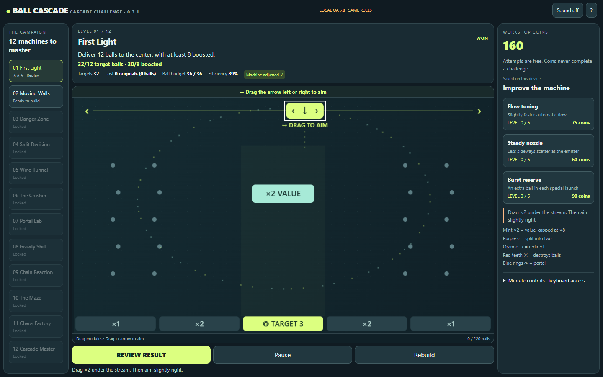 | 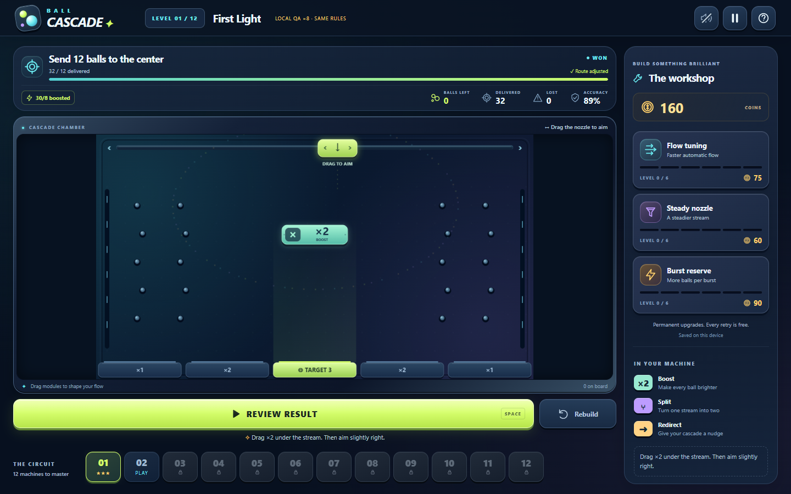 |

## Responsive visual review

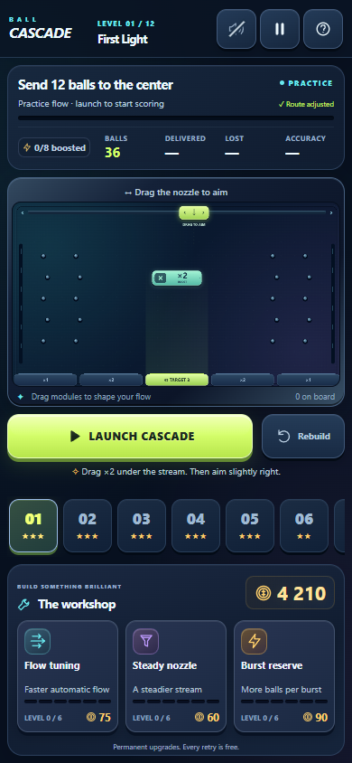

Additional full-resolution captures: [Android 360×800](visual/after/07-android.png), [compact iPhone-like 375×667](visual/after/07-compact-iphone.png), [tablet 768×1024](visual/after/07-tablet.png), [short landscape 844×390](visual/after/07-landscape.png), [final mission on phone](visual/after/11-mobile-master.png), [trusted touch interaction](visual/after/08-trusted-touch.png), [phone victory](visual/after/10-mobile-victory.png).

Visual inspection found two early problems and prompted another iteration: the mission initially crowded the portrait board, and the short landscape board was too small. The mission was compressed; short landscape now moves it beside the board, with the workshop below it. The sidebar uses intrinsic content height so complex extra conditions cannot be clipped. Tiny stage-name labels were replaced by numbers/stars with full-name tooltips. Workshop price/tier labels and the main touch controls were enlarged.

The final responsive matrix checks **60 mission/viewport combinations** (12 levels × five sizes): no document horizontal overflow, no clipped mission conditions, visible proportional Canvas, and ≥44px primary/pause touch controls. Portrait keeps the board near the top and scrolls workshop content internally. The 16:9 simulation is preserved, so short landscape still has side space rather than distorting or cropping the world.

## Functional and browser evidence

| Level | Before | After | After active time | Target efficiency |
|---|---|---|---:|---:|
| 1. First Light | won | won | 15.5s | 89% |
| 2. Moving Walls | won | won | 54.0s | 86% |
| 3. Danger Zone | won | won | 35.1s | 100% |
| 4. Split Decision | won | won | 48.7s | 100% |
| 5. Wind Tunnel | won | won | 47.7s | 100% |
| 6. The Crusher | won | won | 62.7s | 73% |
| 7. Portal Lab | won | won | 40.7s | 86% |
| 8. Gravity Shift | won | won | 69.2s | 97% |
| 9. Chain Reaction | won | won | 44.1s | 100% |
| 10. The Maze | won | won | 61.7s | 97% |
| 11. Chaos Factory | won | won | 76.2s | 100% |
| 12. Cascade Master | won | won | 83.2s | 100% |

- **64 Node checks pass**, covering existing physics, all missions, losses/retries, money, saves/migration, object limits, pointer mapping, smooth gestures and the new compact mission presentation.
- Before and After each completed all twelve in real Chromium through the UI. Local QA ×8 changes only simulation speed; no completion flags, outcomes, prices or budgets are assigned. Different UI action timing can change a few deliveries; the canonical deterministic balance JSON remains exactly unchanged.
- Trusted CDP-emulated touch dragged the actual booster/nozzle and completed First Light. Pause froze emissions; a real Flow purchase cost exactly 75 coins (160 → 85); reload retained completion, layout, aim, balance and upgrade level.
- Browser page/console errors: 0 in the full After campaign; 0 in interaction checks. External game requests in the interaction run: 0.
- Reduced motion: optional particle emission is zero and computed CSS transition duration is 0s. Required ball movement remains playable.

Raw evidence: [Before campaign](visual/before/results.json), [After campaign](visual/after/results.json), [touch/save/performance checks](visual/after/interaction-checks.json), [60-case layout matrix](visual/after/layout-matrix.json), [matched comparison state](visual/comparison-state.json).

## Performance and effect limits

A separate synthetic component benchmark draws 220 balls for 120 measured renders after 20 warm-up renders, using the same unchanged Engine snapshot for both renderers. It is not a campaign run or a hardware-phone FPS certification.

| CPU Canvas command submission | Before | After |
|---|---:|---:|
| Mean render call | 0.62ms | 0.92ms |
| 95th percentile | 1.00ms | 6.10ms |

The richer renderer costs more than the original; no speed improvement is claimed. The measured call costs remain below a 16.7ms desktop-frame budget in this headless environment, but GPU presentation, low-end phones and thermal throttling remain unmeasured. Both renderers respect the 180-particle bound; the new run had 10 labels, below its 14-label limit. Background and ball glow are cached; module lights and event emissions are bounded. Rendering the fixture left the Engine snapshot unchanged: true.

## Remaining visual/product limits

This is an original procedural/vector art direction, not a raster illustration pack. The preserved 16:9 world leaves side space in constrained windows and very small world labels on short landscape phones; primary goals and conditions are presented separately in readable DOM UI. Physical iOS/Safari, low-end Android hardware, color-vision user testing and novice preference/retention studies were not performed. Headless Chrome device emulation is not a real-phone certification. No retention, conversion, revenue or platform-approval improvement is asserted.

The design has been visually inspected on the saved real-browser screenshots. Owner review should judge the art direction, play First Light without instructions, try a late obstacle level and review the phone result/workshop. **Do not merge or update public Pages until owner confirmation.**

## Reproduce and review

Use Node 22+ and Playwright in the development environment. No browser-testing package is shipped with the game. Set PLAYWRIGHT_MODULE when Playwright is outside the project, and CHROME_PATH to an installed Chromium binary when needed. Then run:

```sh
node tools/prepare-visual-baseline.cjs
node tools/serve.js --port 8020
# In another terminal:
node --test tests/*.test.js
node tools/visual-qa.cjs before http://127.0.0.1:8020/.qa/before-site/
node tools/visual-qa.cjs after http://127.0.0.1:8020/
node tools/visual-checks.cjs http://127.0.0.1:8020/
node tools/visual-pairs.cjs http://127.0.0.1:8020/
node tools/visual-report.cjs
node tools/build.js
```

The build exports only runtime files to artifacts/site. Tests, baseline copies, screenshots and reports are excluded. The local preview is http://127.0.0.1:8020/ on the owner's computer; no public replacement has been deployed.
